# Feature screenshots

Captured from the running application on 2026-11-15 using isolated headless Chrome. Screenshots are real browser captures, not mockups. The exported report is downloaded through the interface.

## Male anatomy, CAD-style region tree, and lung cancer Sankey diagram

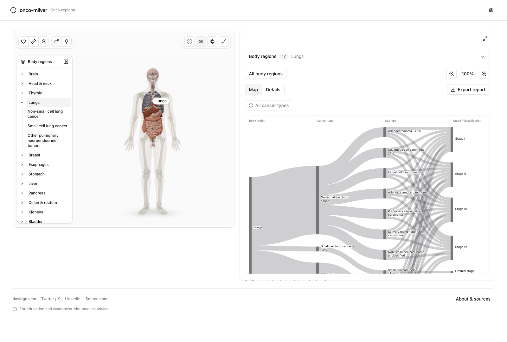

## Opaque skin surface with skin cancer classifications

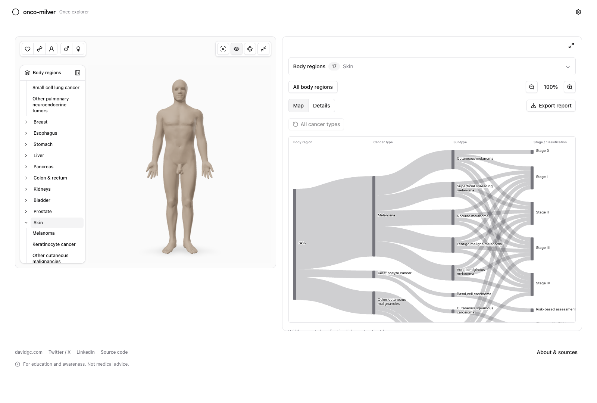

## Visible skeleton with bone sarcoma classifications

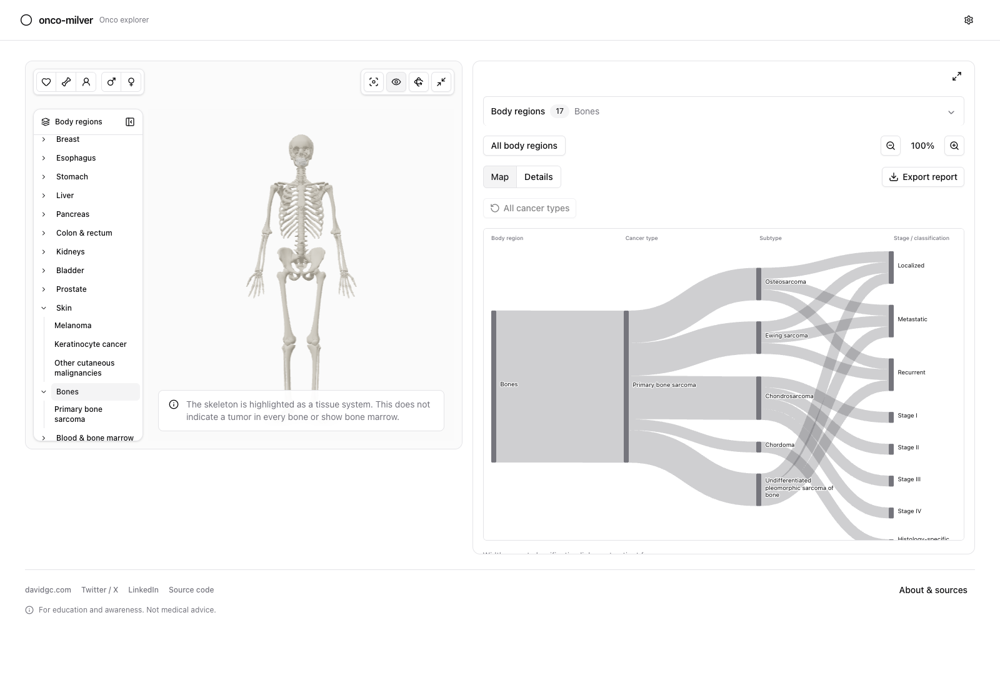

## Female anatomical model and synchronized lung cancer map

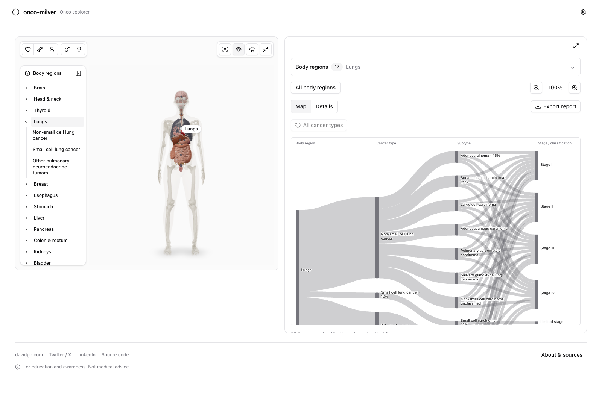

## Subtype breadcrumbs and a sourced frequency estimate with its denominator

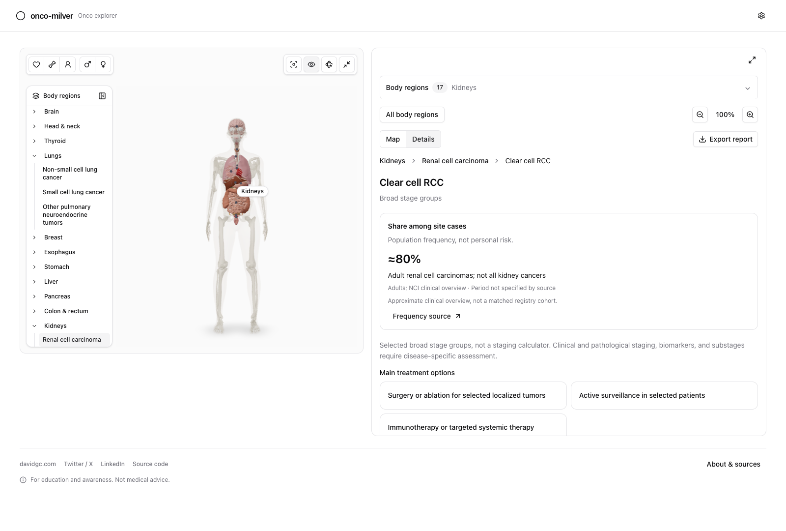

## Educational treatment cards, source links, and disease classifications

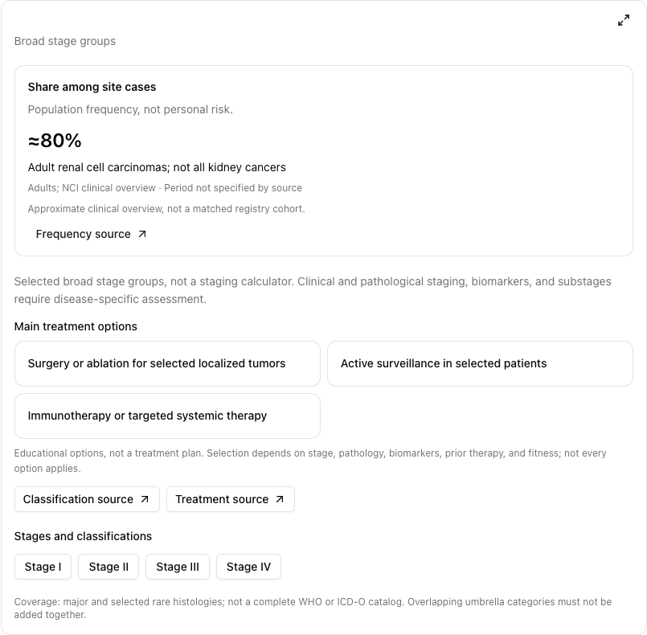

## Report export dialog with branch scope and HTML/PNG download options

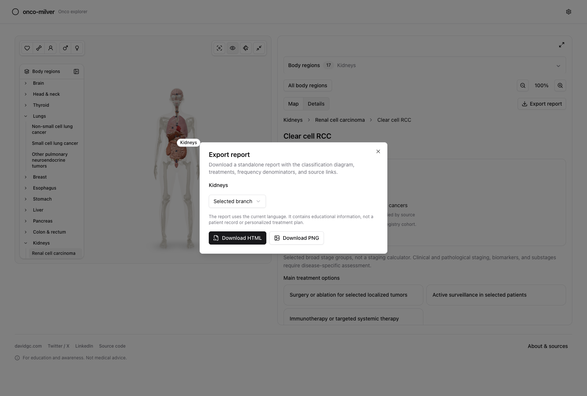

## Actual downloaded standalone HTML report with classification diagram, frequency, treatments, and references

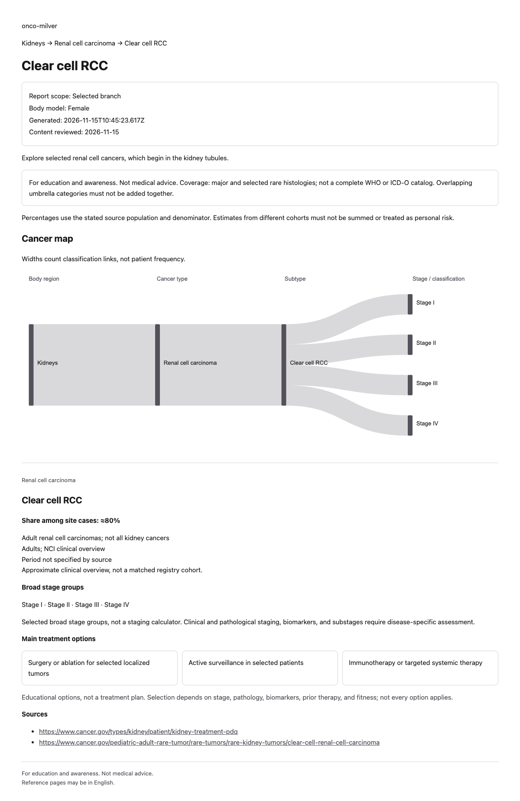

## Centered cancer map with the anatomy panel minimized

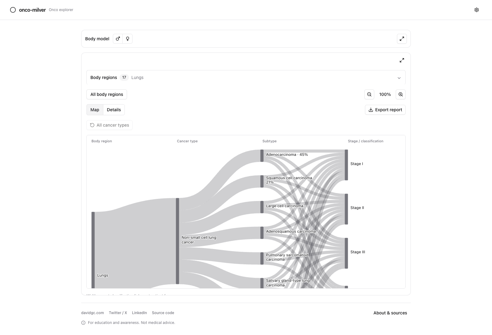

## Movable, resizable cancer map panel

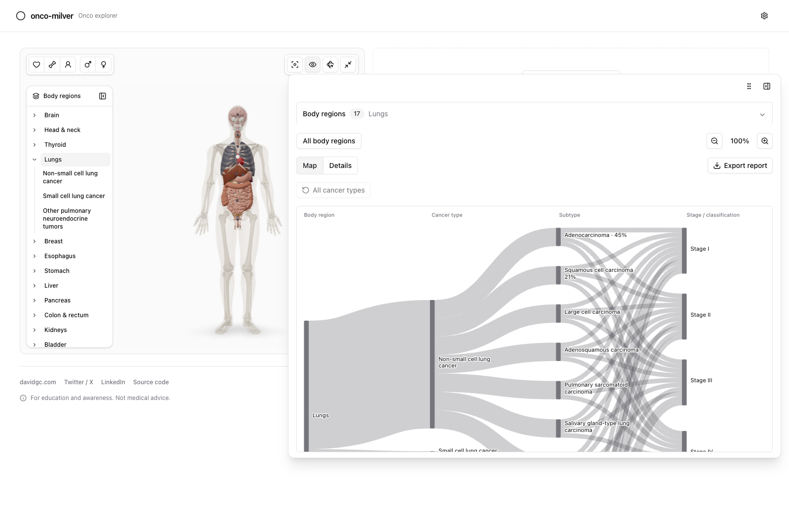

## Spanish translation and selectable palette settings

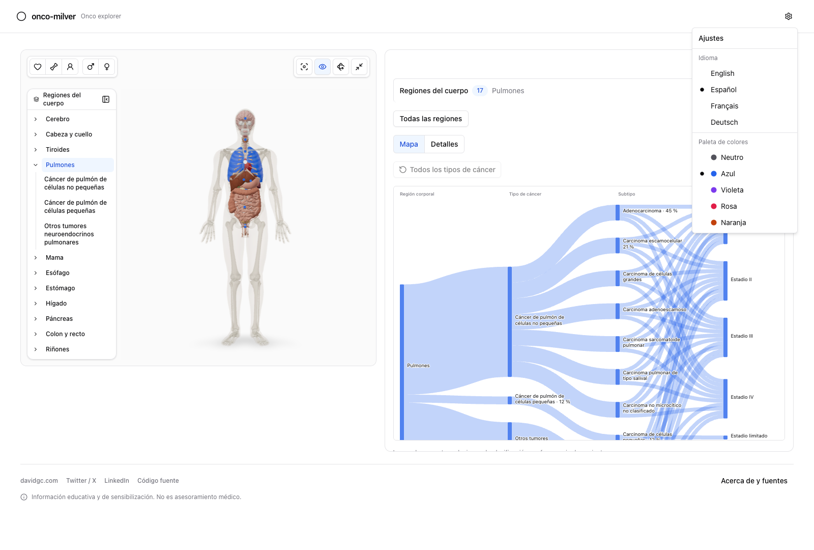

## Mobile anatomy viewer with collapsed CAD navigation, icon controls, and translated cancer map

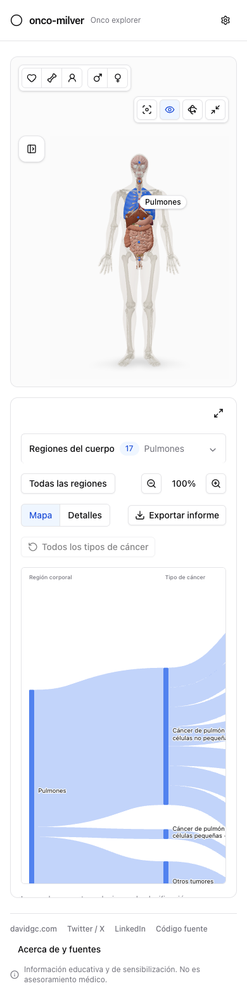

Refresh with `npm run screenshots`; see the root README for setup. Anatomy asset licenses and attribution remain applicable.
